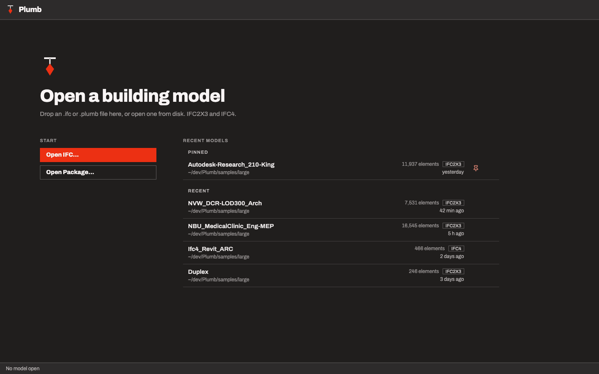
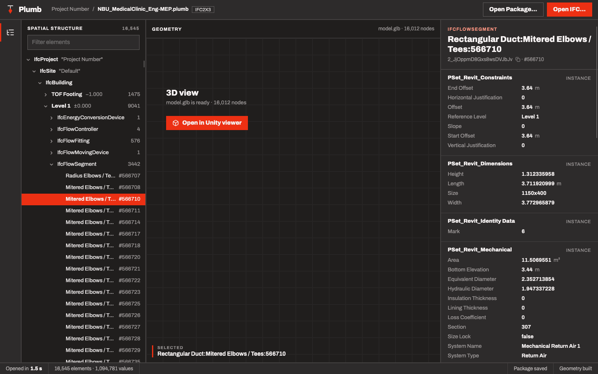
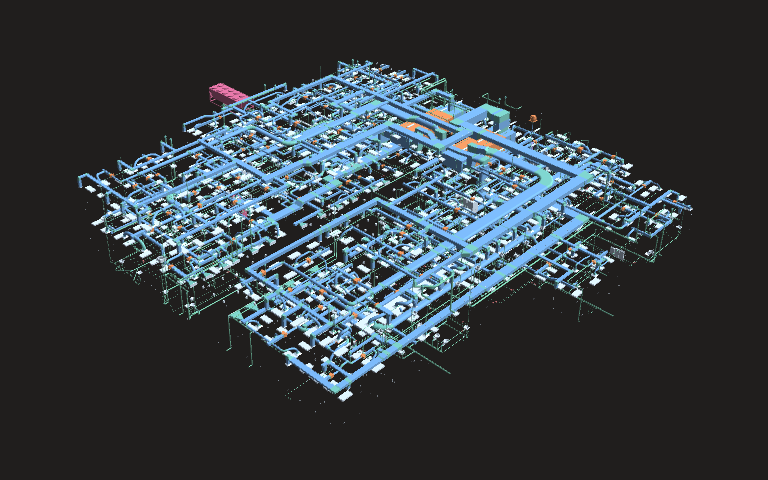
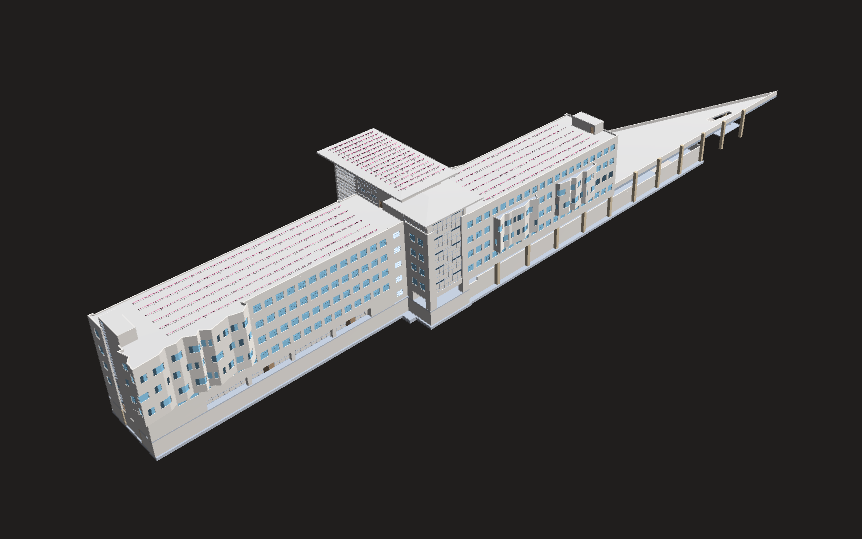

# Plumb

[](https://github.com/sburdenko/plumb/actions/workflows/ci.yml)

Desktop viewer for IFC building models. Open an `.ifc` file, browse its spatial structure and the properties of every element, keep the result as a `.plumb` package that reopens without parsing the IFC again, and inspect it in 3D: click any element to see what it is.

```
              ________________________
             /                       /|    IfcProject "0001"
            /                       / |    └── IfcSite "Default"
    _______/_______________________/  |        └── IfcBuilding
    |      |                       | /|            ├── Roof
    |      |  Roof                 |/ |            ├── Level 2
    |      |_______________________|  |            ├── Level 1
    |      |                       | /|            │   ├── IfcDoor (6)
    |      |  Level 2              |/ |            │   ├── IfcStair (2)
    |      |_______________________|  |            │   ├── IfcWallStandardCase (21)
    |      |                       | /|            │   └── + 5 more types
    |      |  Level 1              |/ |            └── T/FDN
    |      |_______________________|  |
    |      |                       | /
   _|_     |  T/FDN                |/
   \ /     |_______________________|
    V
 ~~~~~~~~~~~~~~~~~~~~~~~~~~~~~~~~~~~~~~~~
```




<p>
  
  
</p>

## Features

- Opens IFC2X3 and IFC4 files by drag and drop, from a file dialog, or on macOS from Finder (Open With) and the Dock icon. The File menu and the Dock menu list recent models.
- Starts on a list of recent models, newest first, with pinned ones on top. A model opens from its package unless the IFC file was saved since, and files that were moved or deleted are marked instead of silently dropped.
- Shows the spatial structure: project, site, building and storeys sorted by elevation, with elements grouped by IFC type. Parts of aggregates, such as stair flights, appear under their parent element and keep its storey.
- Shows instance and type property sets and quantity sets for the selected element. Instance values override type values.
- Resolves units from the project's unit assignment when a property does not specify its own.
- Searches the tree by element name, IFC type, GlobalId or tag, and by property: `FireRating = REI 90`, `Size ~ 1150` (contains), `Area > 10`. Conditions are joined with `;`, so `duct; Size = 1150x400` finds ducts of that size. ⌘F (Ctrl+F on Windows and Linux) jumps to the search box. A click on the GlobalId copies it.
- Opens the package in a Unity viewer: orbit, pan and zoom, click an element to highlight it and see its name, type, storey and GlobalId, press F to frame it. The viewer stays linked to Plumb: an element picked in 3D is selected in the tree with its properties, and one selected in the tree is highlighted and framed in 3D. Colours come from the file's surface styles; geometry without a style, which is most of an MEP model, is coloured by its IFC class.
- Converts the geometry to binary glTF (`model.glb`) with IfcOpenShell's IfcConvert. Every mesh node is named by its IFC GlobalId, so a 3D viewer can map a click back to the element and its properties.
- Saves every import as a `.plumb` package next to the source file. Opening the package skips IFC parsing entirely. When that folder is read-only, the model still opens and the app shows why it was not saved.
- Imports in the background, showing each step of the pipeline with its time, and can be cancelled at any point. A cancelled or failed import never leaves a half-written package behind.
- Keeps the model when a secondary step fails: if the package cannot be saved, or IfcConvert is missing, fails or times out, the tree and properties still open and the app shows why.

## Performance

Measured on a MacBook Pro with Apple M2 Pro and 32 GB of memory, Release builds. Each import is a fresh process, so peak memory belongs to that model alone.

| Model | Schema | IFC | Elements | Property values | Import | `model.glb` | Open package | Peak memory, Plumb / IfcConvert |
|---|---|---:|---:|---:|---:|---:|---:|---:|
| Duplex | IFC2X3 | 2.4 MB | 246 | 12,713 | 1.2 s | 1.0 MB | 15 ms | 0.1 / 0.1 GB |
| Revit architecture sample | IFC4 | 13.6 MB | 466 | 3,032 | 15–19 s | 14.1 MB | 7 ms | 0.2 / 2.4 GB |
| Autodesk 210 King, office | IFC2X3 | 155 MB | 11,937 | 354,945 | 4.0–4.6 min | 114 MB | 0.4 s | 1.1 / 1.8 GB |
| NBU Medical Clinic, MEP | IFC2X3 | 207 MB | 16,545 | 1,094,781 | 3.0 min | 74 MB | 1.2 s | 1.5 / 1.2 GB |
| NVW DCR LOD300, architecture | IFC2X3 | 288 MB | 7,531 | 6,639 | 2.3 min | 108 MB | 34 ms | 1.7 / 2.1 GB |

The Unity viewer on the same packages, in a 1280×800 window with vsync off, while the camera turns around the model:

| Model | Model read | Shown | Clickable | Average FPS | 1% low FPS | Meshes | Triangles |
|---|---:|---:|---:|---:|---:|---:|---:|
| Duplex | 0.2 s | 0.2 s | 0.2 s | 2,147 | 385 | 215 | 26 k |
| Revit architecture sample | 0.2 s | 0.2 s | 0.3 s | 1,278 | 143 | 446 | 362 k |
| Autodesk 210 King | 0.7 s | 0.8 s | 2.4 s | 59 | 53 | 12,673 | 4.1 M |
| NBU Medical Clinic, MEP | 0.6 s | 0.7 s | 1.8 s | 54 | 47 | 16,012 | 4.7 M |
| NVW DCR LOD300 | 0.6 s | 0.6 s | 1.4 s | 107 | 99 | 7,354 | 1.5 M |

- **Geometry is the slow part of an import.** IfcConvert alone takes 226 s of 210 King's import and 105 s of NVW's 139 s; reading the IFC runs alongside it.
- **Opening a package scales with property values, not file size.** The clinic's million values take 1.2 s; the 288 MB architecture model, with few properties, opens in 34 ms.
- **Clicking costs a little after the model appears.** Mesh colliders, which make elements clickable, are added 5 ms per frame after the model is shown, so the camera moves meanwhile. On 12,000 to 16,000 meshes that adds 1 to 2 s.
- The first run of IfcConvert from a new folder takes a few seconds longer while macOS checks the binary.

The large models come from the [DURAARK dataset](https://tib.eu/data/duraark/BuildingData/) at TIB Hannover and from [youshengCode/IfcSampleFiles](https://github.com/youshengCode/IfcSampleFiles). They are not in the repository. To measure a model of your own:

```bash
dotnet run -c Release --project tools/Plumb.Bench -- path/to/model.ifc
"viewer-build/PlumbViewer.app/Contents/MacOS/Plumb Viewer" --package path/to/model.plumb --benchmark result.txt
```

## Architecture

Every project does one job and references only what that job needs. Each box depends only on the boxes below it. `ArchitectureTests` checks these edges on every build. For a plain-language tour and a glossary, see [docs/architecture.md](docs/architecture.md); for every automated test written out as a sentence, [docs/scenarios.md](docs/scenarios.md).

```
                            ┌───────────────────────┐
                            │       Plumb.App       │
                            │  Avalonia desktop UI  │
                            └───────────┬───────────┘
                                        │
                            ┌───────────┴───────────┐
                            │      Plumb.Import     │
                            │   runs the pipeline   │
                            └───────────┬───────────┘
            ┌───────────────────────────┼───────────────────────────┐
            │                           │                           │
┌───────────┴───────────┐   ┌───────────┴───────────┐   ┌───────────┴───────────┐
│       Plumb.Ifc       │   │     Plumb.Geometry    │   │     Plumb.Package     │
│  IFC file to records  │   │ IFC file to model.glb │   │   records to .plumb   │
│        [ xBIM ]       │   │     [ IfcConvert ]    │   │       [ SQLite ]      │
└───────────┬───────────┘   └───────────┬───────────┘   └───────────┬───────────┘
            │                           │                           │
            └───────────────────────────┼───────────────────────────┘
                                        │
                            ┌───────────┴───────────┐
                            │       Plumb.Core      │
                            │  shared records, tree │
                            │     netstandard2.1    │
                            └───────────────────────┘
```

| Project | Job | Key library |
|---|---|---|
| `Plumb.Core` | Records, import results, the element tree, search and clash detection. Targets netstandard2.1, so any .NET runtime can reference it, Unity included. | |
| `Plumb.Ifc` | Reads an IFC file into element and property records. | xBIM |
| `Plumb.Geometry` | Runs IfcConvert to write `model.glb`, with a timeout, and stops it on cancel. | IfcConvert, as a separate process |
| `Plumb.Package` | Writes records into a `.plumb` folder and reads them back, the triangles of `model.glb` included. | SQLite |
| `Plumb.Import` | Runs the steps in order, reports progress, turns every failure into a result. | |
| `Plumb.App` | Drag and drop, tree, property panel. | Avalonia |
| `viewer/` | Unity 6 project: loads `model.glb`, orbit camera, picks elements by GlobalId. | glTFast |

xBIM, IfcConvert and SQLite each appear in exactly one project, so any of them can be replaced without touching the rest.

The 3D viewer is a second program, a Unity 6 project in `viewer/`. It reads the package folder, and a loopback socket keeps the two selections in step:

```
Plumb  --- Open in 3D: PlumbViewer --package Duplex.plumb --link <port> --->  Plumb Viewer (Unity)
                                                                                reads model.glb with glTFast
                                                                                reads elements.json for labels
       <--------------- hello 1 <token>, then select <GlobalId> / clear ---->
```

A click casts a ray, takes the name of the glTF node it hits, which is the element's IFC GlobalId, and looks that id up in `elements.json`. The viewer never opens SQLite.

The link is one line per message, described in `Plumb.Core/Link` and copied in the viewer; `tests/link-examples.txt` holds lines both test suites read, so the copies cannot drift apart. Plumb listens on `127.0.0.1` only and passes a one-time token through the viewer's environment, so no other process can join. Each side remembers the selection the two already agree on, which stops a selection from echoing back. If the viewer is closed, or never connects, both programs keep working on their own, and Open in 3D for the same model brings the running viewer forward instead of starting another.

### Import pipeline

```
Duplex.ifc
   |
   |-- 1  validate   extension and ISO-10303-21 header            Plumb.Ifc
   |-- 2  snapshot   copy the source next to the draft, hash it   Plumb.Import
   |-- 3  read       spatial structure, properties, units         Plumb.Ifc
   |-- 4  geometry   IfcConvert writes model.glb, alongside 3     Plumb.Geometry
   |-- 5  write      database, index and manifest into the draft  Plumb.Package
   '-- 6  publish    rename the draft to Duplex.plumb             Plumb.Import
                     (an existing package is replaced only here)
```

Steps 3 and 4 read the same snapshot, so the model, the geometry and the manifest hash always describe the same bytes, even if the source is saved again during the import. The draft and the snapshot are dot-prefixed folders next to the target. Cancelling, or a failure that stops the import, deletes both, stops IfcConvert and leaves an existing package untouched. Because the draft sits in the same folder as the target, publishing is a rename, not a copy.

### Package format

```
Duplex.plumb/
|-- manifest.json   format version, source name and SHA-256, schema, element count, import time
|-- model.sqlite    elements (with tag and storey elevation in metres) and properties
|                   (marked instance or type), properties indexed by GlobalId
|-- elements.json   id, type, name and storey of every element, for viewers without SQLite
'-- model.glb       binary glTF, one node per element, named by IFC GlobalId
```

The manifest is written last, so a folder without one was never finished. Readers check its format version before touching the database. A package in an earlier format is imported again from the IFC file next to it, which replaces the package; without that file, Plumb says which IFC file to open. When geometry could not be built, the manifest records why, so a reopened package shows the same reason.

### Design decisions

- **Errors are values.** The pipeline returns `ImportResult.Success`, `ImportResult.Failure` with an `ImportError` code, or `ImportResult.PackageOutdated`, and never throws for expected failures. xBIM wraps exceptions thrown from its progress callback, so cancellation is detected from the token rather than the exception type.
- **Secondary steps are states, not errors.** A successful import carries `PackageState.Saved` or `NotSaved`, and a saved package carries `GeometryState.Built` or `NotBuilt`. The UI reads the warning from that state; nothing is a boolean flag.
- **External tools run as separate processes.** IfcConvert (LGPL) is started per import with a time limit, its output is drained while it runs, and its whole process tree is killed on cancel or timeout.
- **The GlobalId is the join key.** IfcConvert names every glTF node by GlobalId, the package indexes elements by GlobalId, and tests check that every node is an element. That is what lets a click in 3D find its data.
- **No coroutines in the viewer.** Loading is a state machine in `Update` that polls glTFast's tasks, so the flow is explicit and easy to step through.
- **Builds check themselves.** `--select <GlobalId> --screenshot <png>` makes the viewer load a package, select an element, save one frame and quit, which is how the screenshot above was taken.
- **Window states are types.** Empty, importing and loaded are separate view models, and the main view model swaps between them instead of toggling flags.
- **Flat records, tree on demand.** Import produces two flat lists keyed by IFC GlobalId, which map one to one onto the SQLite tables. The tree is built from parent ids, and search returns a new pruned tree without touching the original.
- **No Windows-only storage.** Models open with xBIM's `MemoryModel`, because the default `IfcStore` provider may pick the Esent database, which only runs on Windows.
- **Locale-independent numbers.** Values are written with the invariant culture and 10 significant digits, so Revit's `17.38299999999997` becomes `17.383` on any system.

## Getting started

Requires the .NET 10 SDK. Developed on macOS (Apple Silicon); CI builds and tests on macOS, Windows and Linux.

```bash
tools/fetch-ifcconvert.sh
dotnet run --project src/Plumb.App
```

`fetch-ifcconvert.sh` downloads the pinned IfcConvert build for your OS and checks its SHA-256; the build copies it next to the app. Without it the app still runs and shows that 3D geometry was not built.

To use Open in 3D, build the viewer once. This needs Unity 6000.6.5f1 with macOS build support, installed through Unity Hub:

```bash
tools/build-viewer.sh
```

The viewer lands in `viewer-build/` and the next `dotnet build` copies it next to the app. Set `PLUMB_VIEWER` to use a viewer from another location.

To open a file or package on start, pass its path:

```bash
dotnet run --project src/Plumb.App -- path/to/model.ifc
```

To get a standalone `Plumb.app` with its icon, IfcConvert and the viewer inside (Apple Silicon):

```bash
tools/bundle-macos.sh
```

It lands in `dist/` and runs without the .NET SDK installed.

## Tests

```bash
samples/fetch-samples.sh
dotnet test
```

The suite imports the Duplex architecture model and checks the tree, storey order, units and property integrity. It writes and reopens packages, replaces them, cancels mid-write and verifies that no draft is left behind. With the real IfcConvert it checks that every glTF node is an element of the package, that a timeout or cancel stops the process, and that a missing converter still loads the model.

The viewer has its own Unity EditMode tests for argument parsing, the element index, click detection and the link to Plumb:

```bash
Unity -batchmode -projectPath viewer -runTests -testPlatform EditMode -testResults viewer-tests.xml
```

The Duplex model is not stored in the repository because its source publishes no license. `fetch-samples.sh` downloads it from a pinned commit of [youshengCode/IfcSampleFiles](https://github.com/youshengCode/IfcSampleFiles) and verifies its SHA-256.

## Built with

.NET 10, Avalonia 12, CommunityToolkit.Mvvm, Unity 6 with [glTFast](https://github.com/Unity-Technologies/com.unity.cloud.gltfast) 6.20, [xBIM Essentials](https://github.com/xBimTeam/XbimEssentials) 6, [IfcOpenShell](https://github.com/IfcOpenShell/IfcOpenShell) IfcConvert 0.9, Microsoft.Data.Sqlite, NUnit.

## License

MIT. Third-party components keep their own licenses; see [THIRD-PARTY-NOTICES.md](THIRD-PARTY-NOTICES.md).
